<a id="top"></a>

<picture>
  <source media="(prefers-color-scheme: dark)" srcset="docs/assets/banner-dark.svg">
  <source media="(prefers-color-scheme: light)" srcset="docs/assets/banner-light.svg">
  
</picture>

<p align="center">
  
  
  
  
  
</p>

<p align="center">
  <a href="#five-ideas-tested"><b>Verdicts</b></a> ·
  <a href="#where-shoppers-leave"><b>Funnel</b></a> ·
  <a href="#the-experiment"><b>Experiment</b></a> ·
  <a href="#the-dashboards"><b>Dashboards</b></a> ·
  <a href="#what-management-should-do"><b>Decisions</b></a> ·
  <a href="#the-ten-phases"><b>Phases</b></a> ·
  <a href="#run-it-yourself"><b>Run it</b></a>
</p>

<br>

<picture>
  <source media="(prefers-color-scheme: dark)" srcset="docs/assets/receipt-dark.svg">
  <source media="(prefers-color-scheme: light)" srcset="docs/assets/receipt-light.svg">
  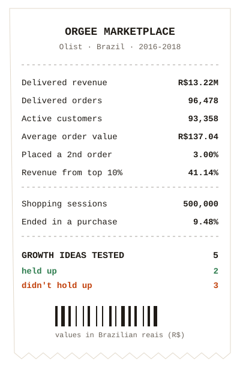
</picture>

**ORGEE** (Omnichannel Retail & Growth Experimentation Engine) asks one practical question a retail growth team faces every quarter:

> *Of all the growth ideas on the table, which ones does the data actually support?*

It starts from **99,441 real orders** from Olist, a Brazilian online marketplace. Real order data says nothing about browsing, marketing or experiments, so the project adds a **Python-generated behaviour layer**: 500,000 sessions, about 3 million clickstream events, 50 campaigns and a controlled A/B test. The synthetic layer is labelled as synthetic everywhere it's used.

Everything lands in a **SQL Server star schema** (16 tables, 28 of 28 validation checks passing). From there the project maps the customer journey, scores every customer by value, builds and tests a recommendation engine, runs the A/B test properly, and ends in **five Power BI dashboards** plus a **what-if page** for management.

What makes it different is the honesty: **three of the five growth ideas did not hold up**, and the project says so as clearly as it reports the two that did.

<br clear="right">

---

<a id="five-ideas-tested"></a>
## Five ideas, tested

<picture>
  <source media="(prefers-color-scheme: dark)" srcset="docs/assets/verdicts-dark.svg">
  <source media="(prefers-color-scheme: light)" srcset="docs/assets/verdicts-light.svg">
  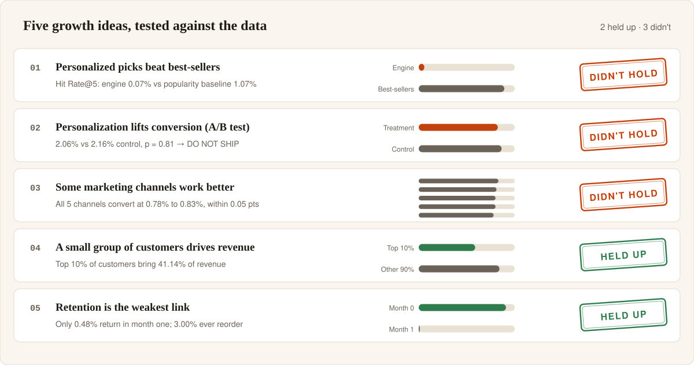
</picture>

| # | The idea | What the data showed | Where |
|:-:|---|---|---|
| 01 | A personalized recommendation engine beats recommending best-sellers | Offline Hit Rate@5 was **0.07%** against **1.07%** for a simple popularity list, about 15× worse | [Phase 7](07_Recommendation_Intelligence/README.md) |
| 02 | Personalization lifts purchase conversion | Treatment **2.06%** vs control **2.16%**, p = 0.8126. Formal decision: **do not ship** | [Phase 8](08_Experimentation/README.md) |
| 03 | Some marketing channels clearly outperform others | All 5 channels convert at **0.78% to 0.83%**, within 0.05 points of each other, which is normal random variation | [Phase 4](04_Advanced_SQL_Analytics/09_Marketing_Performance_Results.md) |
| 04 | A small group of customers drives most of the value | The top 10% bring **41.14%** of revenue. Champions are worth **10.07×** an at-risk customer | [Phase 6](06_Customer_Product_Analytics/README.md) |
| 05 | Retention is the business's weakest link | Only **3.00%** of customers ever place a second order, and **0.48%** come back in month one | [Phase 5](05_Customer_Journey_Analytics/README.md) |

---

<a id="where-shoppers-leave"></a>
## Where shoppers leave

<picture>
  <source media="(prefers-color-scheme: dark)" srcset="docs/assets/funnel-dark.svg">
  <source media="(prefers-color-scheme: light)" srcset="docs/assets/funnel-light.svg">
  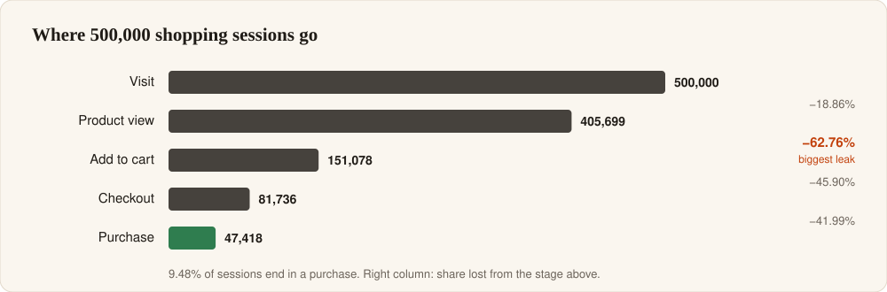
</picture>

The single biggest leak is between **looking at a product and putting it in the cart**: 62.76% of viewing sessions stop there. That is larger than the loss at checkout or at payment. It points to product pages, price clarity and discoverability as the first thing to fix, ahead of more personalization.

After the first purchase, retention falls off a cliff: from 100% to **0.48% in month one**. This number went through a real correction during the project. The first SQL version averaged each monthly cohort's rate equally, so a one-customer cohort with 100% retention counted as much as a cohort of 1,600. The Power BI measure weighted by cohort size and disagreed by more than 10×. The SQL was fixed and re-checked against Phase 4's separately calculated repeat rate ([full write-up](09_PowerBI_Executive_Platform/README.md)).

---

<a id="the-experiment"></a>
## The experiment

<picture>
  <source media="(prefers-color-scheme: dark)" srcset="docs/assets/abtest-dark.svg">
  <source media="(prefers-color-scheme: light)" srcset="docs/assets/abtest-light.svg">
  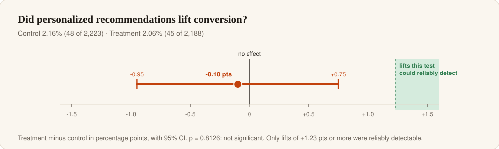
</picture>

Test `exp_001` compared a **best-sellers** list (control) with **personalized recommendations** (treatment). It followed a fixed plan, decided before looking at the results:

1. **Sample ratio check first.** A chi-square test on the 49,720 / 49,721 assigned users confirmed the split was clean before any result was read.
2. **Significance test.** A two-proportion z-test, written directly in T-SQL, gave p = 0.8126. The answer was later reproduced exactly in Python with `scipy.stats` ([validation](08_Experimentation/python%20validation/python_validation_results.md)).
3. **Decision.** The result was **do not ship**. There was no significant lift, the point estimate was negative, and the engine had already lost to best-sellers offline.

One honest caveat: with about 2,200 eligible users per group, the test could only reliably detect a lift of **1.23 points or more**. It shows *no evidence that personalization helps*, which is not the same as proving it has no effect. Detecting a realistic 10% lift would need about 71,000 users per group.

---

<a id="the-dashboards"></a>
## The dashboards

Five pages for five audiences, with synced category and date slicers, a metric switcher, and drill-through from Sales to Product. The report file is in the repo: [`ORGEE.pbix`](09_PowerBI_Executive_Platform/ORGEE.pbix) (50 MB).

<table>
  <tr>
    <td width="50%"><b>Executive</b><br><sub>Revenue, orders, customers, conversion, repeat rate</sub><br>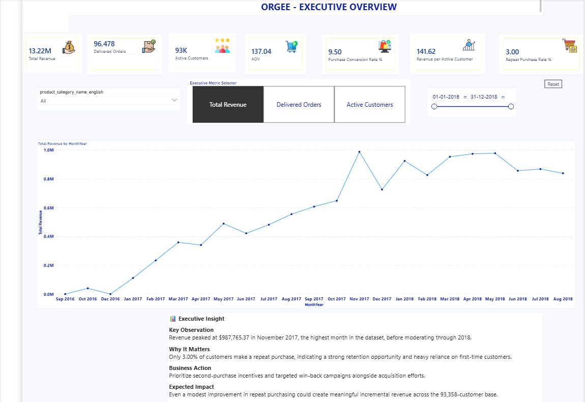</td>
    <td width="50%"><b>Sales</b><br><sub>Categories, sellers, revenue concentration</sub><br>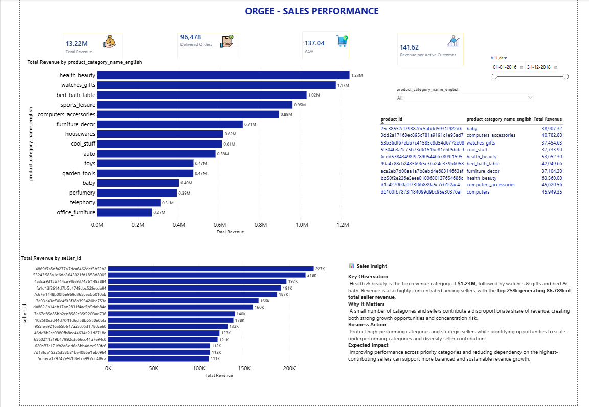</td>
  </tr>
  <tr>
    <td><b>Customer</b><br><sub>RFM segments, lifetime value, retention curve</sub><br>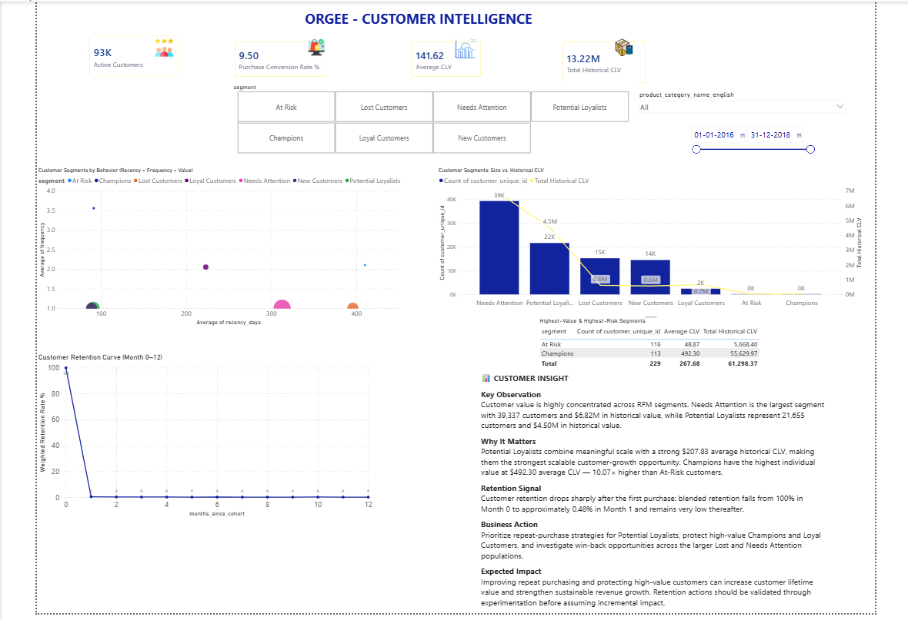</td>
    <td><b>Product</b><br><sub>Funnel, recommendation evaluation, experiment result</sub><br>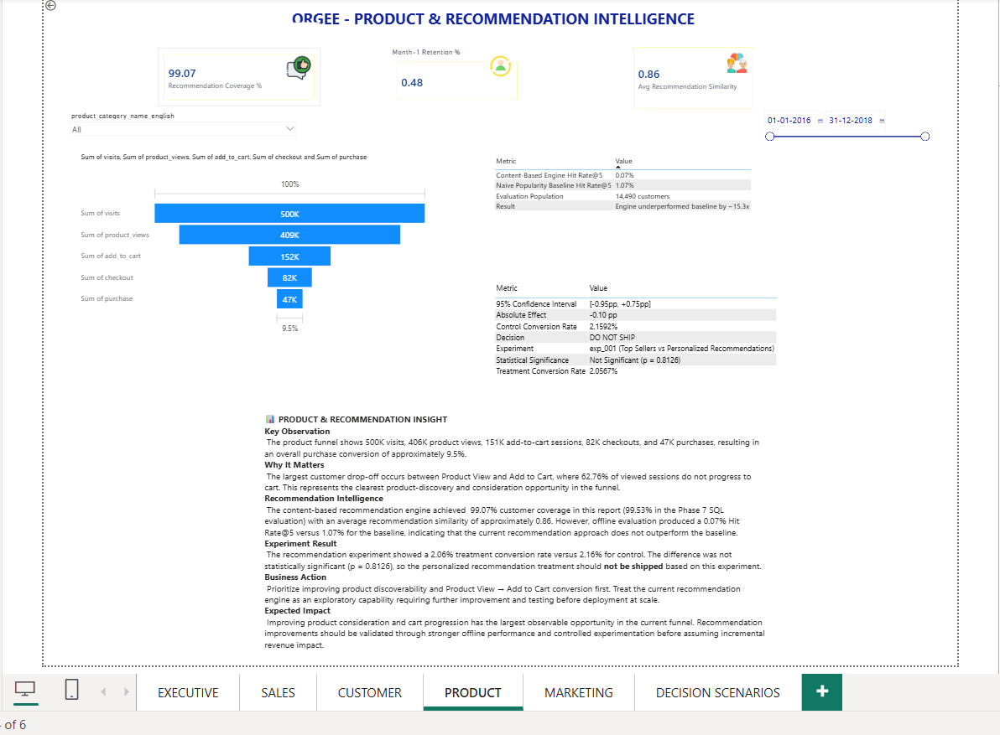</td>
  </tr>
  <tr>
    <td><b>Marketing</b><br><sub>Campaign and channel performance</sub><br>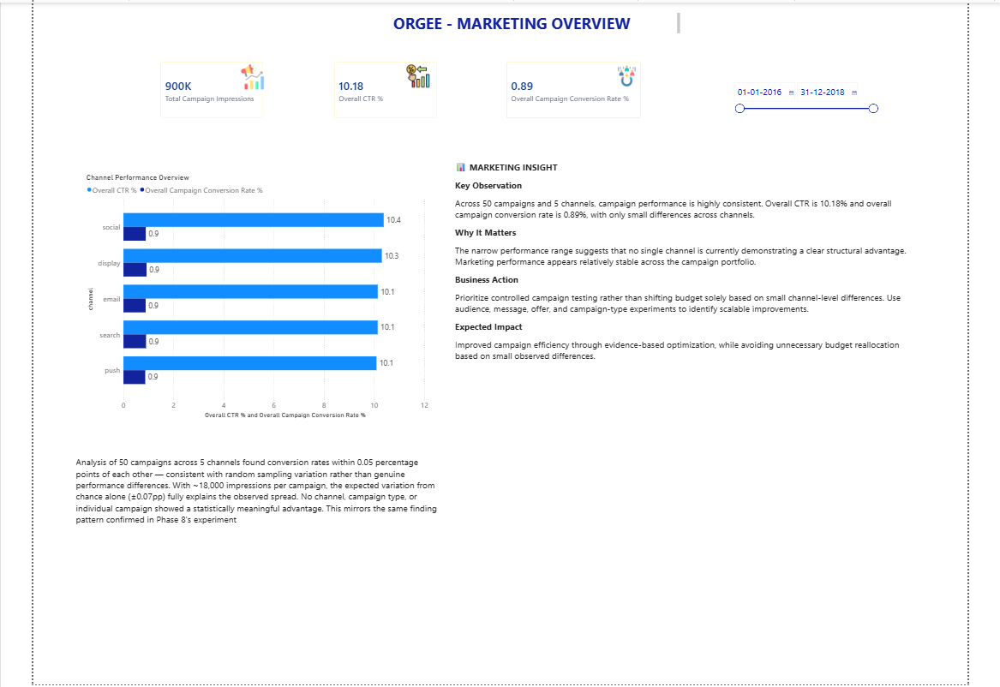</td>
    <td><b>Decision scenarios</b><br><sub>What-if sliders for conversion, repeat rate and order value</sub><br>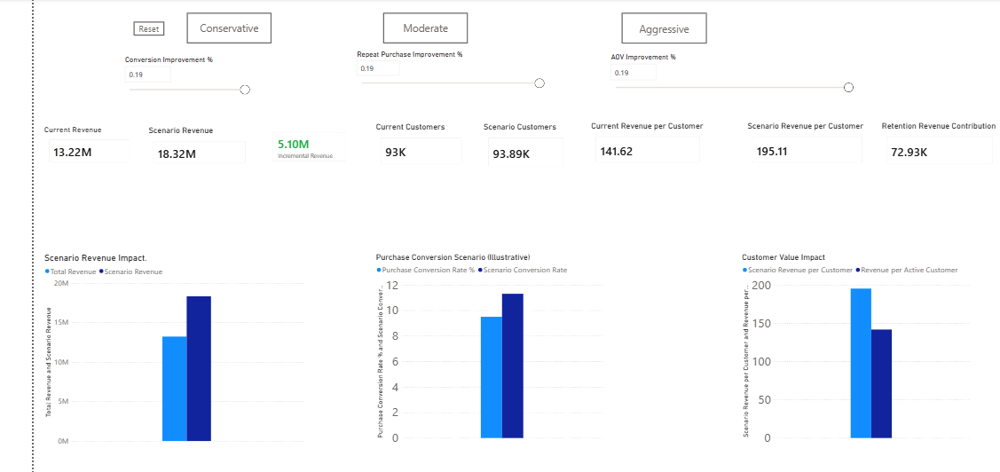</td>
  </tr>
</table>

The what-if page holds a lesson of its own. Raising conversion and order value by 19% each adds about **R$2.5M** apiece, but a 19% relative lift in repeat purchases adds only about **R$73K**, because so few customers return to begin with. Small tweaks to retention won't move revenue; it needs a step change. Every scenario figure is labelled as an illustration, not a forecast.

---

<a id="what-management-should-do"></a>
## What management should do

| | Recommendation | Why | Priority |
|:-:|---|---|:-:|
| 🛒 | **Fix the product-view-to-cart step first** | It loses 62.76% of engaged sessions, the largest leak in the funnel | High |
| 🔁 | **Rebuild the first month after purchase** | Only 0.48% return in month one. Second-order incentives belong here, not spread over a year | High |
| 💎 | **Spend retention money by segment** | Champions are worth 10.07× at-risk customers, and the top 10% bring 41.14% of revenue | High |
| 🚫 | **Don't deploy the current recommendation engine** | It lost offline (0.07% vs 1.07%) and in the A/B test (p = 0.81). Treat it as research | High |
| 📣 | **Test before moving marketing budget** | No channel is meaningfully better, so shifting spend now would be guesswork | Medium |

---

## How it was built

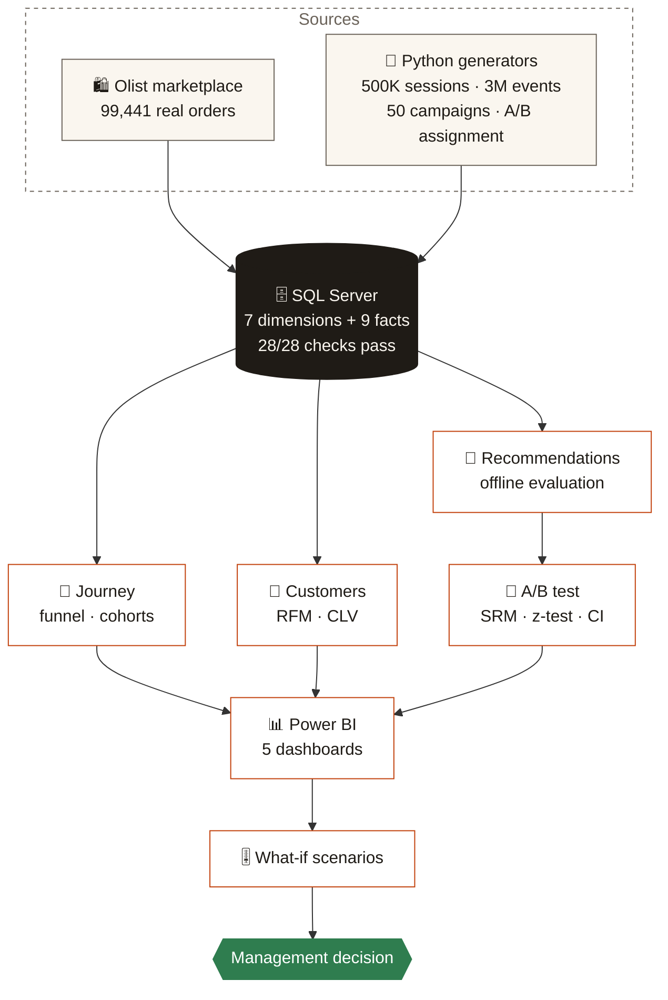

---

<a id="the-ten-phases"></a>
## The ten phases

| Phase | Question it answers | Headline result |
|---|---|---|
| [01 Business understanding](01_Business_Understanding/01_Executive_Summary.md) | What problem, for whom, measured how? | Written last, so it reflects what the project actually found |
| [02 Hybrid data engineering](02_Hybrid_Data_Engineering/01_Public_Data_Contract.md) | Can real orders and synthetic behaviour be joined honestly? | 261,831 duplicate geolocation rows found and resolved |
| [03 SQL warehouse](03_Enterprise_SQL_Warehouse/09_documentation/README.md) | Is there one trustworthy source of truth? | 16 tables, 28 of 28 validation checks pass |
| [04 Advanced SQL analytics](04_Advanced_SQL_Analytics/README.md) | Where does revenue come from? | Top 10% of customers bring 41.14% of revenue |
| [05 Customer journey](05_Customer_Journey_Analytics/README.md) | Where do shoppers drop off, and do they come back? | 62.76% leak before the cart; 0.48% return in month one |
| [06 Customer & product analytics](06_Customer_Product_Analytics/README.md) | Which customers are worth keeping? | Champions are worth 10.07× at-risk customers |
| [07 Recommendation intelligence](07_Recommendation_Intelligence/README.md) | Does personalization beat best-sellers offline? | No: 0.07% vs 1.07% Hit Rate@5 |
| [08 Experimentation](08_Experimentation/README.md) | Does it lift conversion in a controlled test? | No: p = 0.8126, do not ship |
| [09 Power BI platform](09_PowerBI_Executive_Platform/README.md) | Can each team see its numbers in one place? | 5 cross-filtered dashboards |
| [10 Decision scenarios](10_Decision_Scenarios/README.md) | What happens if management pulls a lever? | Conversion and order value move revenue; small retention gains barely do |

---

## Built with

<p>
  
  
  
  
  
  
</p>

The A/B statistics were written by hand in T-SQL, including the normal-distribution approximation, rather than handed to a library. The point was to show the method is understood; Python then confirmed the same answer.

---

<a id="run-it-yourself"></a>
<details>
<summary><b>Run it yourself</b></summary>

<br>

1. Download the [Olist dataset from Kaggle](https://www.kaggle.com/datasets/olistbr/brazilian-ecommerce) into `data/raw/Public/`.
2. Clean the public data: `python python/phase_02_public_data_cleaning.py`
3. Generate the behaviour layer from `python/generators/`. Run `04` (sessions), `05` (events), `03` (identity links), `03b` (identity backfill), then `06` to `09`. Settings live in `01_generator_config.py`.
4. In SSMS, set `@BasePath` in `03_Enterprise_SQL_Warehouse/05_data_load/02_bulk_load_staging.sql` to your `data\` folder. Turn on **Query → SQLCMD Mode** and run `07_warehouse_build/master_build.sql`.
5. Run the SQL in phases 04 to 08 in numeric order. Each phase ends with its own validation script.
6. For Power BI, run `09_PowerBI_Executive_Platform/00_prerequisite_checks.sql` and `01_powerbi_aggregation_views.sql`, then open `ORGEE.pbix` and refresh.

</details>

<details>
<summary><b>The data</b></summary>

<br>

**Real (Olist, 2016 to 2018):** 99,441 orders, 112,650 order items, 32,951 products, 3,095 sellers across 71 categories, plus payments, reviews and geolocation.

**Synthetic (generated in Python):** 500,000 sessions, about 3,000,000 events, 50 campaigns across 5 channels, inventory snapshots, cross-device identity links and one A/B experiment. Every generation rule is documented in [Phase 2](02_Hybrid_Data_Engineering/06_Enterprise_Generation_Rules.md).

**Currency:** Olist values are Brazilian reais. This page and Phase 4 write R$; the dashboards and some phase documents write $ for the same reais amounts.

**Files too large for GitHub,** hosted on Google Drive and fully reproducible from the scripts above:
[`events.csv`](https://drive.google.com/file/d/11hVTD_9GRkK-DlvMsBFr45i0A-7pvh8I/view?usp=drive_link) (362 MB) ·
[`campaign_exposures.csv`](https://drive.google.com/file/d/1BkWYIp0p2nzSJ43dNpke1v3w3qTXUdUv/view?usp=drive_link) (108 MB) ·
[`inventory_observations.csv`](https://drive.google.com/file/d/1HtT-xueyAtUMmAS3pPgEw_R8w4EPv4yr/view?usp=drive_link) (89 MB) ·
[`olist_geolocation_dataset.csv`](https://drive.google.com/file/d/1tj4grRnNVFQX57K0eE_0NWPXS2ml_zqD/view?usp=drive_link) (58 MB, raw) ·
[`sessions.csv`](https://drive.google.com/file/d/1jDxmWkbzxn0y6FPJURXuVxLQpzm5D3wh/view?usp=drive_link) (52 MB)

Revenue, customer and retention figures count only orders with `order_status = 'delivered'`.

</details>

<details>
<summary><b>Limitations</b></summary>

<br>

- Sessions, events, campaigns and the experiment are **synthetic**. They're realistic by design, but findings about browsing, channels and the A/B test describe the simulation, not real Olist shoppers.
- The A/B test could only detect large effects (+1.23 points or more), so it rules out a big win, not a small one.
- The what-if levers are modelled **independently**, with no interaction between them. They show what a change *would* produce, not how likely or costly it is.
- There is no real marketing spend, attribution, returns or customer-service data, so ROI and cost-to-serve are out of scope.
- The recommendation verdict applies to this content-based approach only. Other methods were not tested.

</details>

<details>
<summary><b>Future work</b></summary>

<br>

- Re-test recommendations with collaborative filtering or a hybrid model, against the same popularity baseline.
- Size the next experiment for a realistic lift (around 71,000 users per group for a 10% relative lift).
- Add interaction effects to the what-if model, and a time-series forecast alongside it.
- Replace the hard-coded customer count in the Power BI coverage measure with a live count.

</details>

<details>
<summary><b>Repository structure</b></summary>

<br>

```text
ORGEE/
├── 01_Business_Understanding/        problem, objectives, stakeholders, KPIs, scope
├── 02_Hybrid_Data_Engineering/       data contracts, quality gates, generation rules
├── 03_Enterprise_SQL_Warehouse/      DDL, keys, loads, indexes, master build, validation
├── 04_Advanced_SQL_Analytics/        revenue, products, sellers, customers, marketing
├── 05_Customer_Journey_Analytics/    funnel, drop-off, cohorts, retention curves
├── 06_Customer_Product_Analytics/    RFM, CLV, North Star metric, KPI tree, priorities
├── 07_Recommendation_Intelligence/   content-based engine and offline evaluation
├── 08_Experimentation/               design, SRM, metrics, significance, decision
│   └── python validation/            scipy cross-check of the A/B statistics
├── 09_PowerBI_Executive_Platform/    ORGEE.pbix, aggregation views, DAX and model reference
├── 10_Decision_Scenarios/            what-if design and validation
├── python/                           cleaning, generators and validation scripts
├── data/                             raw, processed and generated CSVs (large files on Drive)
└── docs/                             README graphics and the script that builds them
```

</details>

---

<div align="center">

**Built by [Anto Abraham A J](https://github.com/ANTO-ABRAHAM-AJ)**

<sub>Real orders from Olist · behaviour layer synthetic and labelled as such · graphics built by <code>docs/build_readme_assets.py</code></sub>

<sub>[Back to top ↑](#top)</sub>

</div>
